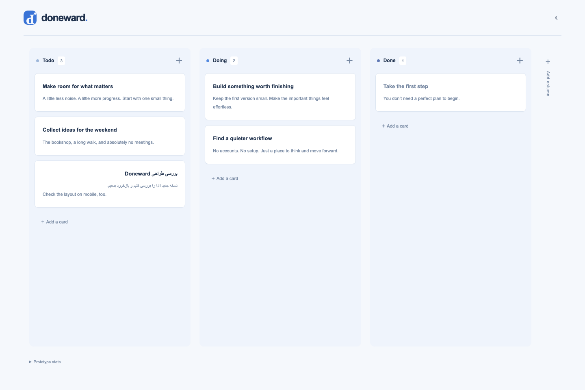
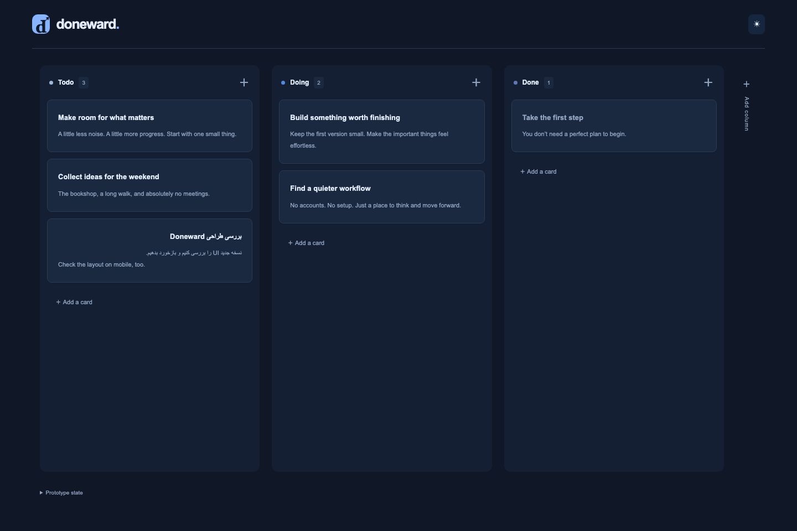
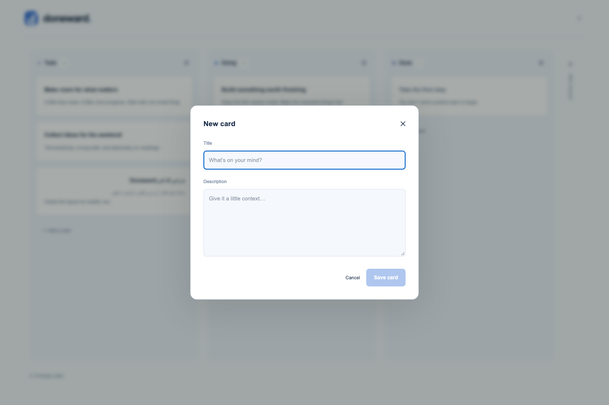
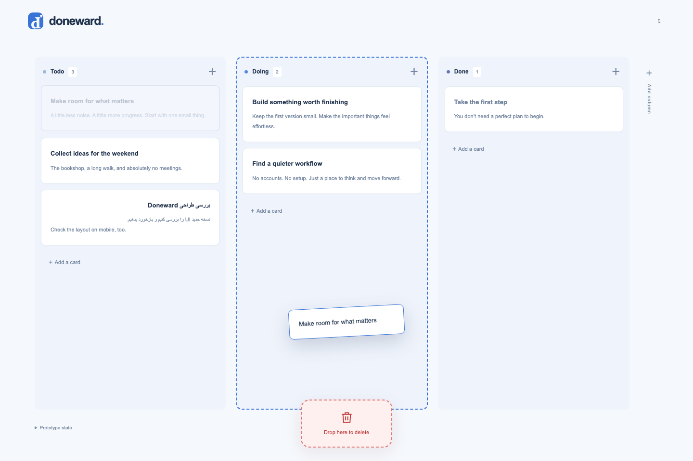
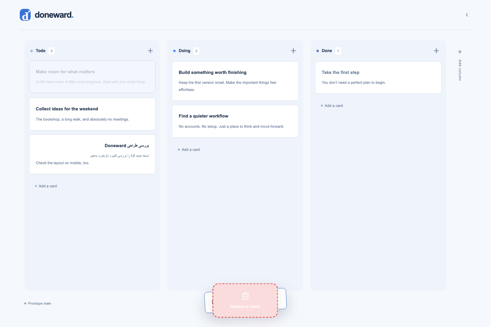
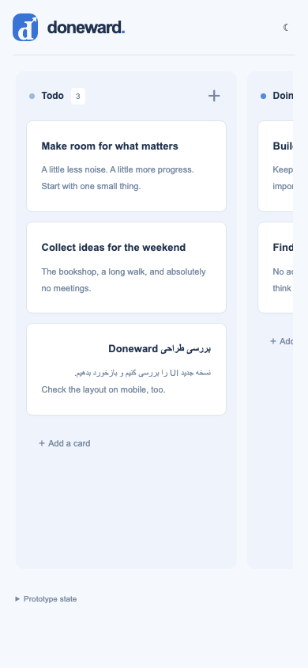

# Approved board design

**Status:** Approved by the maintainer on 2026-11-17, after reviewing the revised variant A.

**Question settled:** What should Doneward's board look and feel like?

**Verdict:** Keep the side-by-side canvas board, revised to a blue palette and a board-first page. Discard variants B and C and the variant switcher. The approved direction keeps the columns immediately visible without a hero or competing layout.

## Sources and precedence

- [Issue #1: v1 specification](https://github.com/saeed-mosavat/doneward/issues/1) defines product scope and behavior.
- This document records the approved visual direction and its interaction refinements. These replace the original prototype variations, not unrelated requirements in the specification.
- Screenshots below are visual references, not permission to reproduce prototype omissions. Written requirements take precedence if a screenshot or the archived code conflicts with them. Surface any unresolved conflict before changing the design.
- [Archived prototype branch](https://github.com/saeed-mosavat/doneward/tree/prototype/approved-board) is the runnable primary source. Its entry point is `src/app/prototype/board/prototype-board.tsx`, with styling in `src/app/prototype.css`.

## Page hierarchy

- A minimal header: Doneward's logo and wordmark on the left; a compact theme control on the right.
- The board follows directly below the header. No page title, hero, subtitle, tagline, sidebar, dashboard, or global New card banner.
- Maintainer refinement (2026-11-19): use compact page padding and a smaller wordmark/header so columns start within the top 90px on desktop and narrow screens. The board fills the remaining viewport height.
- Do not show a persistent saved-on-this-device footer. Keep saving announcements available to assistive technology and storage failures visibly actionable.
- Side-by-side columns occupy the available board area, with generous vertical space. Narrow viewports scroll columns horizontally instead of stacking them vertically.
- Each column header starts with its drag handle, followed by its user-defined name and an add-card button. Do not display colored dots or card-count indicators. A second Add a card action follows its cards.
- Column titles use prominent 18px type and wrap long mixed-direction names without displacing the column controls.
- A narrow, borderless Add column action follows the last column on the right, with a plus icon above a vertically oriented label, as shown in the visual references.
- Column contextual actions pair icons with text labels. Clicking or tapping outside an open column menu closes it without blocking the outside action.
- Cards show their title and optional description. The entire card opens the editor. No Open card label, decorative ellipsis, or card footer is needed.
- Card previews are at most 240px high: titles show at most two lines and descriptions at most six lines. Keep the full original content available in the editor, saved data, and backups; clipping is visual only.
- Do not infer fixed status semantics from column names or positions: columns are customizable. The prototype's muted Done cards are illustrative, not a requirement to mark a renamed or third column completed.

## Palette and treatment

Use a blue-toned visual system: cool near-white page background, pale blue column surfaces, white cards, dark navy primary text, muted blue-gray secondary text, and blue actions/focus indicators. Dark mode keeps the blue character with deep navy surfaces and light text.

Follow the system theme until the user chooses light or dark. Persist that choice across refreshes and tabs; unavailable preference storage must not disable the toggle.

Reference tokens from the approved prototype:

| Role           | Light     | Dark      |
| -------------- | --------- | --------- |
| Page           | `#f5f8fc` | `#101827` |
| Card/dialog    | `#ffffff` | `#1b2940` |
| Primary text   | `#20324d` | `#e2ebfa` |
| Secondary text | `#7587a1` | `#91a5c3` |
| Border         | `#dce5f1` | `#2a3b56` |
| Accent         | `#3973d6` | `#88b4ff` |
| Tint           | `#e9f0fb` | `#17263f` |

These are starting tokens, not a completed accessibility audit. Adjust contrast where necessary while preserving the approved blue direction. Use understated borders and shadows, rounded cards/columns, compact sans-serif typography, and clear keyboard focus.

## Card creation and editing

- A column's add-card action opens a New card dialog already bound to that column. **Hide the column selector in this creation flow.**
- Clicking anywhere on an existing card opens Edit card. On desktop (above 600px), omit Column and Position inputs from the edit form; a separate Move card dialog keeps non-drag movement available. Its choices remain drafts until the card is saved. On narrow screens, retain the inline movement controls.
- The dialog has title and description fields, Save and Cancel, and a close control. Keep the specification's unsaved-edit discard confirmation.
- Preserve required-title validation, input limits, automatic persistence of committed edits, and accessible keyboard/touch paths from issue #1.

## Drag-to-delete

- Starting a card drag reveals a fixed red trash-bin drop area near the bottom center of the viewport, similar to removing an app from an Android home screen.
- The resting target has a red bin icon, a pale red background, a dashed red border, and Drop here to delete text.
- Hovering the dragged card over the target visibly strengthens it: solid red background, light icon/text, and Release to delete text.
- The dragged card stays visually above the trash target, including its active state, while remaining pointer-transparent so the target can detect hovering and drops.
- Releasing over the target opens the normal deletion confirmation, including the card title. Confirming deletes; cancelling leaves the card and its order unchanged.
- Releasing elsewhere must not delete. Hide the target when the drag ends or is cancelled.
- The bin is a deletion gesture, **not** a trash/recycle-bin feature. Deleted cards do not enter a recoverable collection; trash history and undo remain out of scope.
- Retain a non-drag delete action and accessible movement alternatives. A pointer-only gesture is not sufficient for production.
- Card dragging also supports moving between columns and ordering within a column, as specified in issue #1.

## Mixed-direction content

Keep the interface and column sequence LTR. User-defined column names, card titles, descriptions, and corresponding inputs support mixed RTL/LTR content. Detect title/name direction from the first strong directional character; determine direction separately per description paragraph. Persian-first text reads RTL while embedded English runs remain LTR. Preserve saved text unchanged.

## Visual references

Screenshots captured from the approved prototype using Chromium. Desktop viewport: 1440 × 960. Mobile viewport: 390 × 844. Sample content is illustrative; the real first visit still has only the welcome card defined in the specification.

### Light board



### Dark board



### Column-scoped creation



### Dragging and delete target





### Narrow viewport



## Prototype boundaries

The archived code is throwaway, not the production starting point. Rewrite the selected design with production requirements and tests. In particular:

- In-memory sample data, multiple sample cards, and the Prototype state disclosure are demo scaffolding. Do not ship them or treat them as the initial-state design.
- Persistence, import/export, offline caching, multi-tab coordination, recovery, and update notifications are not implemented in the prototype. They remain required.
- The prototype lacks complete column management, keyboard movement, dialog focus management, unsaved-edit protection, and production-quality touch/scroll behavior. These omissions do not reduce scope.
- Browser-native prompt/confirmation boxes are shortcuts, not approved final dialog styling.
- Theme detection/toggle implementation and drag mechanics are illustrative, not an architecture decision.
- Necessary production controls such as import/export and column management must fit the minimal header or contextual menus; their exact placement was not resolved by this prototype. Seek clarification if a ticket needs a materially different layout.

## Instructions for planning and TDD

- Link this document from each UI-related ticket, and copy the relevant observable requirements into acceptance criteria.
- Include column-scoped creation, whole-card opening, card movement/order, reveal/hover/cancel/confirm drag-to-delete paths, keyboard alternatives, and mixed-direction content in behavioral coverage where relevant.
- Use screenshots to guide layout, palette, spacing, and responsive structure. Do not assert prototype sample copy, its debug panel, or incidental pixel values as product behavior.
- Keep the other scope and test requirements from issue #1; this design is not a replacement specification.

## Running the archive separately

From an existing clone, create a separate worktree so main stays free of throwaway code:

```sh
git fetch origin
git worktree add --detach ../doneward-design origin/prototype/approved-board
cd ../doneward-design
npm ci
npm run prototype
```

Open `http://localhost:3000/prototype/board`. Changes live in memory and reset on reload.
